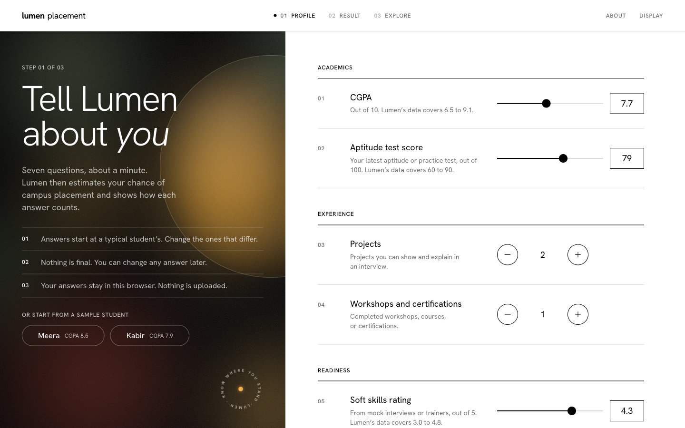
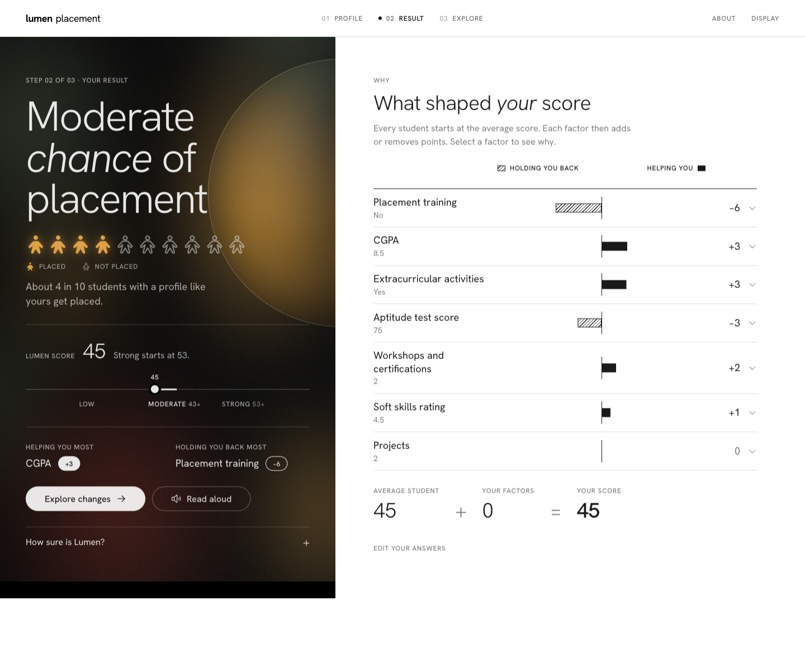

# HCI Project

**Lumen** estimates a student's chance of campus placement, shows which of their answers moved the score, and names the smallest change that would lift it into the next band.

It is the mini-project for AIM4141 Human Computer Interaction at Manipal University Jaipur. What you type stays in the browser tab.



## Try it

Live site: [hci-project-weld.vercel.app](https://hci-project-weld.vercel.app)

Locally, with Node 22 or newer:

```bash
cd app
npm install
npm run dev
```

`npm test` checks that the points shown for each factor add up to the score on screen. `npm run build` produces the production build.

## Three steps

1. **Profile.** Seven questions, already filled with a typical student. Change the answers that differ. Meera and Kabir are sample students if you want to skip ahead.
2. **Result.** The chance in words ("about 4 in 10"), a score, and a chart of what raised it and what pulled it down.
3. **Explore.** Change any answer and the chance updates at once. Your saved answers stay where they were, and undo returns to them.



## Where the score comes from

Lumen is a logistic regression, and the points on screen are that model. The weights that produce the probability are the same weights drawn as the chart.

Training data is the public [Campus Recruitment](https://huggingface.co/datasets/Krooz/Campus_Recruitment_CSV) dataset (CC0). It has 10,000 student records, 9,928 after duplicate rows are removed. A stratified 80/20 split (seed 42) holds out 1,986 students for testing and trains on the remaining 7,942.

Class 10 and 12 marks are left out because a student can no longer change them. Internships are left out because, with the other factors present, they did not improve cross-validated predictions. Seven factors remain: CGPA, aptitude, projects, workshops and certifications, soft skills, placement training, and extracurricular activities.

Inputs are standardised, and 5-fold cross-validation picks the regularisation (C ≈ 0.066). The fitted model is then written as an additive score. Everyone starts at the average student's score of 45, each answer adds or removes points, and the rounded points still sum to the score you see.

| | Lumen | Always guessing "not placed" |
|---|---:|---:|
| Accuracy on the 1,986 held-out students | 81% | 58% |
| ROC AUC | 0.879 | — |
| Brier score, lower is better | 0.138 | — |

Under a probability of 0.30 the chance is low, and the score sits below 43. From 0.30 up to 0.60 the chance is moderate. From 0.60 the chance is strong, which starts at a score of 53.

The records come from one campus, and the model never sees the interview, the branch, or which companies are hiring. Read the result as a guide.

To retrain and regenerate the scorecard the app reads:

```bash
python3 -m venv model/.venv
model/.venv/bin/pip install -r model/requirements.txt
model/.venv/bin/python model/train.py
```

That rewrites `app/src/model/scorecard.json` and `model/metrics.json`.

## Why it looks like this

The course asks for the principles to show up in the product, so the layout is the argument.

- **Seven questions, in three groups.** A short list is easier to weigh (Hick's law), and seven items sits inside what working memory can hold (Miller).
- **The outcome stays put.** On a wide screen the chance lives in the dark panel on the left while you edit on the right. On a phone it follows you in a bar at the bottom, which is where a thumb rests.
- **One fact, said three ways.** A row of ten people, a sentence, and a score all report the same chance. Factors that help are solid bars. Factors that hold the score back are hatched, so the chart still reads in greyscale and in print.
- **Every action can be taken back.** Undo and redo are always available (Shneiderman). Explore also offers the smallest set of changes that reaches the next band, and applying it is itself one undoable step.
- **The pointer decides the target size.** Controls are at least 44px with a mouse and 48px on a touch screen (Fitts's law). A number can be typed instead of dragged.
- **The model reports its own limits.** About states the training set, how often the estimate was right, what was left out, and that a score is not a verdict.

## In the repository

| Path | What it is |
|---|---|
| `app/` | The interface. React, TypeScript, and Vite. |
| `model/train.py` | Trains the regression and exports the scorecard. |
| `model/data/` | The Campus Recruitment records, CC0. |
| `screenshots/` | Desktop and phone captures of the interface. |

Denel B John · 23FE10CAI00465 · AIM4141 Human Computer Interaction · Dr. Sanjay Kumar Tehariya
